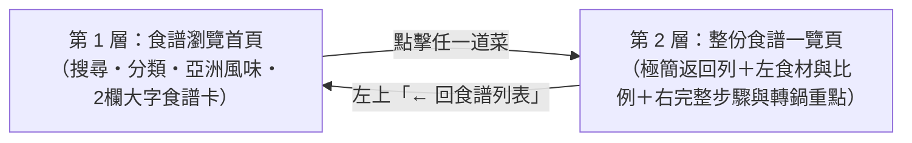

# UI/UX 設計規格書：Tefal 鮮呼吸智能萬用鍋（CY625870）廚房食譜瀏覽器

本文件定義 `tefu-cookbook` 的使用者體驗與介面設計規格，整合 `docs/spec/` 已彙整的 **CY625870 原廠規格、實戰避坑經驗與 52 道亞洲萬用鍋食譜**，作為前端開發與驗收的依據。

---

## 1. 產品定位與使用者畫像

### 一句話定位
> **「極簡零干擾的廚房大字食譜本（每步驟直標 CY625870 按鍵）」**

### 目標使用者畫像（Persona）
* **年齡與視力**：60 歲長輩，有老花眼；全站統一採用**清晰大字與高對比暖紙配色**，不設字體切換鍵。
* **料理能力**：**料理老鳥**——非常熟悉備料、調味與火候判斷，唯一需求是看清楚 **CY625870 電子鍋每一步要按左邊還是右邊、鎖不鎖蓋、設幾分鐘**。
* **使用場景**：**iPad mini 6（8.3 吋觸控平板）** 放廚房邊看邊煮，習慣**一進食譜馬上看到食材與全部步驟**，不需要上下一步翻頁、不需要計時器、不需要語音朗讀、不需要打勾或寫備忘。

### 已確認前提（定案）
1. **主要閱讀裝置**：**iPad mini 6**（橫放 `1133 × 744`、直放 `744 × 1133` CSS px），橫放左食材右步驟、直放單欄順讀，同時相容電腦螢幕。
2. **開啟與部署方式**：**PWA 靜態網頁＋GitHub Pages 自動部署**（iPad mini 6 Safari「加到主畫面」即全螢幕無網址列、離線快取、進入食譜自動防休眠）。
3. **第一版收錄範圍**：亞洲區域優先全收錄，共 **52 道**（台式／中港 24 道、日式 17 道、韓式 2 道、南洋／亞式 9 道）。
4. **純淨零雜訊**：無登入、無本機備忘／收藏／計時器／語音朗讀／勾選框，把 8.3 吋畫面 100% 留給食譜本身。

---

## 2. 核心 UX 設計原則

1. **首頁零頂部雜訊**：拿掉標題列、收藏、字體切換、來源篩選與教學浮層，打開直接是搜尋框、分類、亞洲風味與大字食譜卡片。
2. **全站統一大字、高對比暖米紙**：背景 `#FAF7F1`、深墨黑字 `#1D1B18`，正文 `20–22px`、菜名 `24–30px`，免切換字體大小。
3. **點進食譜立刻見菜（無多餘總覽區塊、無上下步翻頁）**：頂部只留極簡返回列與雙時間／內鍋標籤，畫面立刻進入「左食材＋右完整步驟」一頁看完。
4. **每個步驟直標 CY625870 面板按鍵**：用 🟠 左側無壓（開蓋／蓋上不鎖）與 🔵 右側壓力（順時鐘鎖緊上蓋＋洩壓方式）色條直接嵌在每一步裡，站在鍋前瞄一眼就按對。
5. **誠實雙時間＋老鳥轉鍋重點**：清楚區分 `設 X分` 與 `開飯約 Y分（含升壓＋洩壓）`，步驟下方附上與瓦斯爐差異的轉鍋重點與避坑提醒。
6. **廚房自動不暗屏**：打開食譜自動啟用 Screen Wake Lock。

---

## 3. 資訊架構（極簡純 2 層）



---

## 4. 視覺設計系統

* **暖米紙底**：`#FAF7F1`｜**卡片白**：`#FFFFFF`（邊框 `#DDD5C7`）｜**主文字**：`#1D1B18`｜**次文字**：`#4E4840`
* **🟠 左側・無壓行程**：主色 `#A83E1D`／淡底 `#FFF3E8`（開蓋或蓋上不鎖定）
* **🔵 右側・壓力行程**：主色 `#184275`／淡底 `#EDF4FC`（順時鐘鎖緊上蓋）
* **🟡 老鳥轉鍋重點**：主色 `#6E3F00`／淡底 `#FFF8DC`｜**避坑提醒**：`#8C2119`／`#FDEDEC`
* **固定大字級**（`PingFang TC` ＋ `tabular-nums`）：頁標題 `30px`、卡片菜名 `24px`、步驟正文 `22px`（行距 `1.75`）、食材 `20px`、按鈕與標籤 `18px`。

---

## 5. 兩大畫面線框

### 5.1 畫面 1：食譜瀏覽首頁（iPad mini 6 橫放 2 欄／直放 1 欄）

```text
+------------------------------------------------------------------------------+
| 🔍 [ 搜尋菜名、食材或按鍵（例：雞腿、牛肉、紅豆、舒肥）        ] [✕清除]      |
|                                                                              |
| 分類：[全部 52] [燉滷・主菜] [煲湯・進補] [飯・粥・甜湯] [蒸煮・兩菜] [低溫舒肥] [無壓烘烤] |
| 風味：[全部] [台式] [日式] [韓式] [南洋]                                       |
+------------------------------------+-----------------------------------------+
| 台式        ⏱ 設 23分・開飯約 45分  | 台式        ⏱ 設 28分・開飯約 55分      |
| 台式三杯雞                          | 養樂多滷肉／古早味控肉                   |
| 先開蓋麻油煸薑炒香，鎖蓋壓 15 分...  | 五花肉先乾煎逼油，壓 15–20 分入口即化... |
| [🟠左側・爆炒] ➔ [🔵右側・雞鴨豬] ➔ | [🟠左側・爆炒] ➔ [🔵右側・雞鴨豬] ➔      |
| [🟠左側・收汁]                      | [🟠左側・收汁]                          |
+------------------------------------+-----------------------------------------+
```

### 5.2 畫面 2：整份食譜一覽頁（精簡返回列＋橫向按鍵步驟列＋左食材右完整步驟）

```text
+------------------------------------------------------------------------------+
| [← 回食譜列表]  台式三杯雞 [台式]      ⏱ 設23分・開飯約45分 [球釜不沾內鍋] [☀螢幕不暗] |
+------------------------------------------------------------------------------+
| ┌─────────────────────┐   ┌─────────────────────┐   ┌─────────────────────┐  |
| │ ① 🟠 左側・無壓區    │   │ ② 🔵 右側・壓力區    │   │ ③ 🟠 左側・無壓區    │  |
| │ 【 爆炒煎烤 】       │ ➔ │ 【 雞 / 鴨 / 豬 】   │ ➔ │ 【 收汁 / 醬燒 】    │  |
| │ 🔓開蓋  ⏱約5分鐘     │   │ 🔒鎖緊上蓋 ⏱15分鐘   │   │ 🔓開蓋  ⏱3–5分鐘     │  |
| │ 麻油煸薑炒雞         │   │ 動態變壓・自然洩壓    │   │ 收濃拌九層塔         │  |
| └─────────────────────┘   └─────────────────────┘   └─────────────────────┘  |
+-------------------------------+----------------------------------------------+
| 【食材與比例】 [2人][4人][6人] │ 【完整步驟】                                  |
|                               │                                              |
| 主材料                         │  ① 爆香老薑蒜頭並拌炒雞肉                    |
| 帶骨雞腿肉 切塊        600 克  │     [🟠 左側・無壓區｜按「爆炒煎烤」｜開蓋｜5分]|
| 老薑 切薄片             15 片  │     開蓋選左側「爆炒煎烤」，下黑麻油煸老薑...  |
| 蒜仁                     8 顆  │                                              |
| 九層塔                   1 大把│  ② 鎖蓋高壓快速入味                          |
|                               │     [🔵 右側・壓力區｜按「雞/鴨/豬」｜鎖蓋｜15分]|
| 調味料與液體                   │     蓋上鍋蓋並順時鐘鎖緊，按右側「雞/鴨/豬」... |
| 黑麻油                   2 大匙│                                              |
| 米酒                     3 大匙│  ③ 開蓋收汁拌入九層塔                        |
| 醬油                     2 大匙│     [🟠 左側・無壓區｜按「收汁/醬燒」｜開蓋｜3-5分]|
| 醬油膏                   1 大匙│     開蓋按左側「收汁/醬燒」滾 3–5 分鐘...      |
| 冰糖                     1 小匙│                                              |
|                               │  💡 老鳥轉鍋重點：壓力鍋密封不蒸發，醬汁少1/3… |
| （純淨清單，無勾選框）          │  ⚠ 避坑提醒：醬油膏糖分高，收汁時稍拌防焦黏…  |
|                               │  [▶ 看 YouTube 實作影片]                    |
+-------------------------------+----------------------------------------------+
```

---

## 6. 明確排除項目（Never）

* 不做首頁頂部標題列、收藏清單、字體切換、來源篩選或額外教學浮層。
* 不做「上一步／下一步」步驟翻頁精靈。
* 不做重複佔位的「這道菜怎麼按 CY625870？」大標題外框（改以精簡的 `① ➔ ② ➔ ③` 橫向按鍵步驟列直接呈現在頂端）。
* 不做計時器、語音唸步驟、食材打勾框、或個人備忘輸入框。
